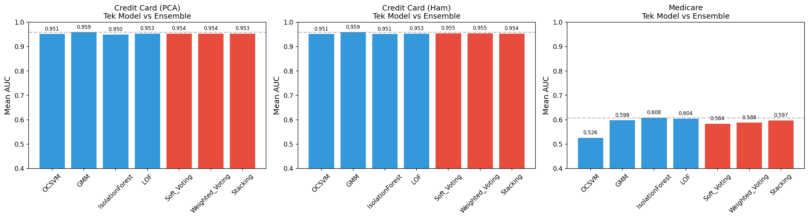

# Fraud Detection with One-Class Classifiers and Score Ensembles

This study trains one-class anomaly detectors (One-Class SVM, Gaussian Mixture Model, Isolation Forest, Local Outlier Factor) on legitimate records only and scores held-out data from two fraud datasets: the Kaggle credit card dataset and a Medicare Part D dataset labelled with the LEIE exclusion list. It then combines the detector scores with soft voting, AUC-weighted voting and stacking, and compares the ensembles with the single models.

On the credit card data every detector and every ensemble lands between 0.950 and 0.959 mean AUC, and no ensemble beats the best single model (GMM, 0.959). On Medicare all methods stay close to chance (0.526 to 0.608 mean AUC); Isolation Forest is the best single model and again no ensemble exceeds it. Training on the majority class gives far better results than training on the minority class (0.945 to 0.958 vs 0.434 to 0.661 AUC on credit card), which agrees with the reference paper.

## Results

### Single models vs ensembles

Source: `Code_Model_Training/Model_Ensemble_Methods.ipynb`, saved to `outputs/ensemble_summary_all.csv`. Each dataset is subsampled to 100,000 rows (stratified), evaluated with 3-fold stratified cross-validation, and each detector is fitted on 10,000 legitimate rows of the training fold. Values are the mean over the 3 folds.

| Method | Credit Card (PCA) AUC | AUPRC | Credit Card (raw) AUC | AUPRC | Medicare AUC | AUPRC |
|---|---|---|---|---|---|---|
| OCSVM | 0.9514 | 0.2731 | 0.9514 | 0.2731 | 0.5261 | 0.0019 |
| GMM | 0.9588 | 0.5720 | 0.9588 | 0.5720 | 0.5977 | 0.0023 |
| Isolation Forest | 0.9496 | 0.1543 | 0.9512 | 0.1215 | 0.6081 | 0.0038 |
| LOF | 0.9532 | 0.6391 | 0.9532 | 0.6391 | 0.6043 | 0.0021 |
| Soft voting | 0.9535 | 0.4672 | 0.9548 | 0.4654 | 0.5840 | 0.0031 |
| Weighted voting | 0.9535 | 0.4675 | 0.9548 | 0.4653 | 0.5877 | 0.0032 |
| Stacking | 0.9532 | 0.5191 | 0.9536 | 0.5179 | 0.5974 | 0.0037 |

Subsample sizes: 173 fraud rows out of 100,000 for credit card, 120 out of 100,000 for Medicare.



The figure has one panel per dataset variant (Credit Card PCA, Credit Card raw, Medicare) with mean AUC on a 0.4 to 1.0 axis. Blue bars are the four single models, red bars are the three ensembles, and the dashed line marks the best single model. Panel titles are in Turkish: "Ham" means raw and "Tek Model" means single model.

What the numbers show:

- Credit card: AUC is saturated across methods (0.950 to 0.959), so the differences are in AUPRC. LOF has the highest AUPRC (0.639), then GMM (0.572). Averaging scores pulls AUPRC down to about 0.47 because OCSVM and Isolation Forest have low AUPRC; stacking recovers to 0.52 but stays below LOF and GMM.
- Medicare: the ensembles sit below Isolation Forest in AUC (0.584 to 0.597 vs 0.608). Their fold-to-fold standard deviation of AUC is lower (0.001 to 0.004) than that of the single models (0.016 to 0.029).
- PCA vs raw credit card features: OCSVM, GMM and LOF give the same result to four decimals; only Isolation Forest changes. The PCA step keeps all 28 components of V1-V28, so it does not reduce dimensionality.

### Standalone model notebooks

These notebooks run each model family separately with repeated stratified k-fold. Values are means over all folds and repeats as printed in the saved notebook outputs.

Credit card, PCA features, full dataset (284,807 rows, 492 fraud):

| Model | Trained on | AUC | AUPRC | Notebook |
|---|---|---|---|---|
| OCSVM (sigmoid calibration) | majority | 0.9449 | 0.3033 | `Model_Training_GMM_OCSVM_CreditCardDataset.ipynb` |
| OCSVM (isotonic calibration) | majority | 0.9547 | 0.3101 | same |
| GMM (sigmoid calibration) | majority | 0.9575 | 0.4949 | same |
| OCSVM (sigmoid calibration) | minority | 0.4344 | 0.0041 | same |
| OCSVM (isotonic calibration) | minority | 0.6251 | 0.0048 | same |
| GMM (sigmoid calibration) | minority | 0.6614 | 0.0133 | same |
| Isolation Forest | majority | 0.9521 | 0.1220 | `Model_Training_IsolationForest_LOF_CreditCard.ipynb` |
| LOF | majority | 0.6425 | 0.0039 | same |

Medicare, 100,000-row stratified subsample (120 fraud), detectors fitted on 10,000 legitimate rows:

| Model | Trained on | AUC | AUPRC | Notebook |
|---|---|---|---|---|
| OCSVM | majority | 0.5326 | 0.0022 | `Model_Training_GMM_OCSVM_MedicareDataset.ipynb` |
| GMM | majority | 0.5857 | 0.0023 | same |

For comparison, the reference paper reports AUC 0.9496 and AUPRC 0.4971 for One-Class GMM (sigmoid) trained on the majority class of the credit card dataset, which this study matches (0.9575 / 0.4949). On Medicare the paper reports AUC 0.7289 and AUPRC 0.1481 for the same model on 2013-2019 data; the 2017-2019 subsample used here does not reach that (0.5857 / 0.0023).

### Notes on the numbers

- LOF on credit card scores 0.6425 AUC in the standalone notebook and 0.9532 in the ensemble notebook. The setups differ: the standalone run fits on all legitimate training rows without standardising the features, the ensemble run standardises the features and fits on a 10,000-row subset of a 100,000-row sample.
- The stacking meta-learner (logistic regression) is fitted and scored on the same test fold, so its figures are optimistic. The sigmoid and isotonic calibrators in the credit card notebook are fitted the same way.
- The ensemble comparison uses a single repeat of 3-fold cross-validation on a subsample, so small differences between methods should not be read as significant.

## Approach

**Models.** All detectors come from scikit-learn and are fitted on legitimate records only (majority-class training). The credit card GMM/OCSVM notebook also fits them on fraud records only (minority-class training) to reproduce the paper's comparison.

| Model | Configuration |
|---|---|
| One-Class SVM | RBF kernel, `nu=0.01`, `gamma="scale"` |
| Gaussian Mixture Model | 1 component, negative log-likelihood as anomaly score |
| Isolation Forest | 100 trees, `contamination=0.01` |
| Local Outlier Factor | 20 neighbours, `novelty=True` |

**Ensembles.** The four anomaly scores are min-max scaled per fold and combined in three ways:

- Soft voting: unweighted mean of the scaled scores.
- Weighted voting: mean weighted by each model's AUC on the fold.
- Stacking: logistic regression on the four scaled scores.

**Datasets.**

- Credit card: Kaggle `creditcard.csv`, 284,807 transactions, 492 fraud (0.17%). `Time` is dropped, `Amount` is standardised, and V1-V28 are standardised and passed through a 28-component PCA to produce `credit_card_PCA.csv`.
- Medicare: Medicare Part D "Prescribers by Provider and Drug" files for 2017-2019, aggregated per provider (NPI), provider type and year into sum, mean, median, standard deviation, minimum and maximum of five utilisation columns, then joined with LEIE on NPI. A provider-year is labelled fraud when the provider's exclusion year is later than the data year. The provider type is one-hot encoded. The result has 798,496 rows, 956 of them fraud, and 214 features.

**Differences from the reference paper.**

- The paper compares OCSVM, GMM and OCAN as single models. This study adds Isolation Forest and LOF and combines the four detectors with voting and stacking.
- Five ratio features are added to the Medicare data in the ensemble notebook: cost per beneficiary, claims per beneficiary, days of supply per claim, 30-day fills per claim, and drug cost standard deviation over mean.
- The paper uses Part D data from 2013 to 2019. This study uses 2017 to 2019 because of memory limits.
- OCAN, the paper's GAN-based model, is not part of this study.

## Repository layout

```
Code_Data_Processing/
  credit_card_dataset_processing.ipynb        EDA, scaling, PCA -> data/credit_card_PCA.csv
  medicare_dataset_filter_and_combining.ipynb column filter and merge of the 2017-2019 Part D files
  medicare_dataset_leie_merging.ipynb         aggregation, LEIE join, labelling, one-hot encoding
Code_Model_Training/
  Model_Training_GMM_OCSVM_CreditCardDataset.ipynb
  Model_Training_GMM_OCSVM_MedicareDataset.ipynb
  Model_Training_IsolationForest_LOF_CreditCard.ipynb
  Model_Ensemble_Methods.ipynb                single models vs ensembles on all three dataset variants
Documents/                                    reference paper (PDF)
outputs/
  ensemble_comparison_all.png
  ensemble_summary_all.csv                    mean and standard deviation of AUC and AUPRC per method
pickled_storage/                              per-fold (AUC, AUPRC) results saved by each training notebook
requirements.txt
```

Notebook comments and printed output are in Turkish.

## Setup and reproduction

```bash
pip install -r requirements.txt
```

The datasets are not included in the repository. Every notebook reads from and writes to a `data/` folder at the repository root, which has to be created first.

| File expected in `data/` | Source |
|---|---|
| `creditcard.csv` | https://www.kaggle.com/datasets/mlg-ulb/creditcardfraud |
| `Medicare_Part_D_Prescribers_by_Provider_and_Drug_2017.csv`, `..._2018.csv`, `..._2019.csv` | https://data.cms.gov/provider-summary-by-type-of-service/medicare-part-d-prescribers |
| `Leie_Updated.csv` | https://oig.hhs.gov/exclusions/exclusions_list.asp |

The notebooks use relative paths (`../data`, `../outputs`, `../pickled_storage`), so run them from their own folder.

1. Data processing, in `Code_Data_Processing/`:
   - `credit_card_dataset_processing.ipynb` writes `data/credit_card_PCA.csv`.
   - `medicare_dataset_filter_and_combining.ipynb` writes `data/Combined_Medicare_2017_2019.csv`. Each yearly input file has about 25 million rows.
   - `medicare_dataset_leie_merging.ipynb` writes `data/Combined_LEIE_Medicare_2017_2019_DOWNSIZED_1mil.csv`.
2. Model training, in `Code_Model_Training/`: the five `Model_Training_*.ipynb` notebooks are independent of each other and each writes a results file to `pickled_storage/`.
3. Ensemble comparison: `Model_Ensemble_Methods.ipynb` trains its own copies of the four detectors, so it only needs the three processed CSV files. It writes `outputs/ensemble_comparison_all.png`, `outputs/ensemble_summary_all.csv` and `pickled_storage/ensemble_results_all.pkl`.

To execute a notebook without opening it:

```bash
cd Code_Model_Training
jupyter nbconvert --to notebook --execute Model_Ensemble_Methods.ipynb
```

Fold splits and model seeds are fixed (`random_state=42`, incremented per repeat in the standalone notebooks).

## Reference

J. L. Leevy, J. Hancock, T. M. Khoshgoftaar and A. Abdollah Zadeh, "One-Class Classifier Performance: Comparing Majority versus Minority Class Training," 2023 IEEE 35th International Conference on Tools with Artificial Intelligence (ICTAI), 2023. DOI: 10.1109/ICTAI59109.2023.00020. A copy is in `Documents/`.

## Author

Baha Kırbaşoğlu. Term project for BLG607 Data Mining.

## License

MIT
